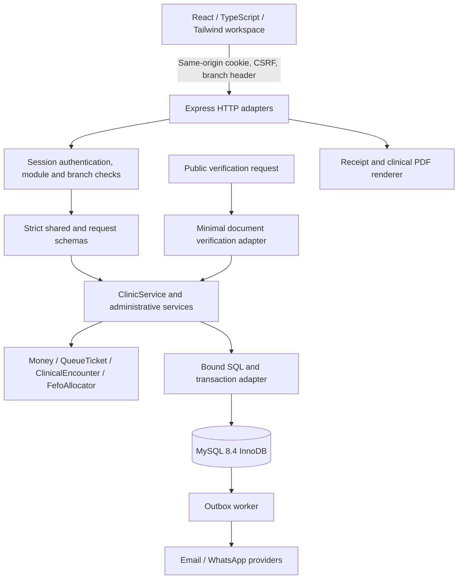

# V2 architecture

The optional global launcher reads fixed reservations and delegates to project `start.ps1`. Clinic verifies configuration, listener ownership and authenticated MySQL readiness before starting Vite3100 and Express3101. Existing local MySQL data stays on3310. Viewer3102, explicit demo3103 and QA3110–3114 have separate reservations. Unknown listeners fail closed; metadata-only logs retain lifecycle history. See [workstation harness](LOCAL_HARNESS.md). New PHP/MySQL hosting defaults do not rewrite this existing Node backend.

## Deployment shape

The system is a modular monolith: one React workspace, one Express API and a separate notification worker share MySQL 8.4.
MySQL/InnoDB is authoritative. Browser state never establishes identity, stock quantities or financial balances.

`shared/countries.ts` provides validated ISO country codes, an OTHER custom-country option, and native `Intl.DisplayNames` labels. Patient `countryCode` identifies nationality independently of phone/address. Migration 016 adds nullable country storage without guessing foreign nationalities; explicitly Malaysian legacy rows receive MY.

`ListControls` provides native search/filter/sort controls across record lists. Its pure shared projection keeps arrays immutable. Existing queries/paging define loaded records. Views preserve original order and selected-record actions; filtered rows never determine authoritative totals.

`PhoneInput` reuses native labelled controls for patient registration and demographic editing. `shared/phone-input.ts` owns country-code presets and split/join rules, sourced from [ITU national numbering plans](https://www.itu.int/oth/t0202). It composes the existing phone string; validation, storage, tenant scope and demo/full-system separation remain unchanged. Unlisted countries use full international entry rather than a new dependency or database table.

## Boundaries and ownership

| Layer                | Responsibility                                                                        | Source                                       |
| -------------------- | ------------------------------------------------------------------------------------- | -------------------------------------------- |
| Browser              | Accessible forms, actual API state, module navigation, loading/error feedback         | `src/client`                                 |
| Shared contracts     | Module IDs, password bounds, positive identifiers, Malaysian IC parsing               | `src/shared`                                 |
| HTTP adapters        | Session context, untrusted input validation, route authorization, error mapping, PDFs | `src/server/app.ts`, routers, `security.ts`  |
| Application services | Workflow coordination, scoped reads, transactions, audit and outbox writes            | `src/server/service.ts`, `administration.ts` |
| Domain behavior      | Money arithmetic, queue transitions, encounter rules and FEFO allocation              | `src/domain/models.ts`                       |
| Persistence          | Pooling, bound parameters, UTC serialization, commit/rollback and migration runner    | `src/server/db.ts`, `src/server/db`          |
| External delivery    | Provider adapters and asynchronous outbox processing                                  | Notifications and worker files               |

Classes encapsulate behavior where invariants matter. Simple record projections remain data rather than empty OOP wrappers.
Shared contracts and reusable forms reduce duplicated logic. Existing services are concrete; a universal repository-interface layer is not claimed.

Clinical document snapshots project through a shared letter view model for browser preview and PDF rendering.
Authenticated projections apply diagnosis redaction and expose display fields rather than signing or verification secrets.
Prescription activity reads existing encounter, reservation and stock-movement ledgers; displaying history does not allocate stock.
Patient medication-taking is a separate scoped clinical ledger with outcome, source, amount, occurrence time and recording staff.
It records reports or observations rather than inferring adherence from stock movements; entries do not alter inventory.

Prescription signing and physical dispensing share the FEFO allocator through explicit reservation-ledger operations.
Signing holds eligible batches inside its encounter transaction; dispensing excludes other holds and records physical movements once.
Inventory item locks serialize competing allocations. General supply usage has its own idempotent header and audited movement allocations, with no medication bypass.

The browser guide uses reusable control anchors and an optional walkthrough overlay.
It explains permitted workflows by highlighting live controls without submitting records.
Responsive navigation, forms and scroll-contained tables share the workspace styles; phone tour instructions fit the viewport.

## Authorization and projections

Authentication resolves an active user, tenant, authorized branch and CSRF token.
Role module permissions refresh on every request. ADMIN retains all modules; chart creation/signing still requires DOCTOR. Patient-taking reports permit DOCTOR or NURSE with clinical access.
Branch membership remains mandatory even when a module is granted.

Composite foreign keys constrain organization relationships, while scoped queries validate selected-branch ownership.
There is no claim of MySQL row-level security. Direct database access bypasses application permissions and stays restricted.

Minimal patient and medication references allow workflows without granting the entire registry or stock module.
The clinical banner and dispensary queue expose only their required fields.
Public certificate verification omits patient identity. The authenticated waiting-room projection omits names and diagnoses.

## Transactions and concurrency

One transaction owns each multi-record operation, including stock receipt/dispensing, checkout, document issuance.
READ COMMITTED transactions use stable resource locks and row locks for cross-row invariants.
Optimistic versions reject stale patient, booking, queue and draft-chart edits.
Booking and MC scope locks serialize overlap checks. Generated queue uniqueness protects active visits and occupied rooms.
Idempotency keys protect dispensing and financial retries. Changed checkout payloads cannot reuse a successful key.

The adapter supports numbered application parameters and limited `RETURNING` behavior through same-transaction follow-up reads.
These are adapter conventions, not native MySQL syntax. SQL changes must fit the supported subset or use explicit native reads.

## Data representation

After migration 009, all entity IDs/FKs are unsigned BIGINT; the API accepts positive JavaScript-safe integers.
Display aliases `tenantNumber`, `branchNumber` and `patientNumber` equal actual entity IDs.
Sequences are table-wide and may contain gaps. Random cryptographic tokens remain strings.

UTC timestamps serialize as ISO strings. Civil dates remain date-only strings; clinic service dates use Asia/Kuala_Lumpur.
Serialization preserves user-defined JSON keys and free text, including text resembling dates.
Patient history uses timestamp/ID cursors to retain records sharing a timestamp.
Typed JSON references require service validation; SQL foreign keys do not validate prescription arrays.

## Notifications and live updates

Transactional outbox creation separates clinic completion from external provider availability.
The worker handles delivery states and retries; unconfigured providers never report success.
Provider acceptance is recorded as SENT, without implying a delivery/read receipt.

Queue events are process-local SSE signals with client refresh fallback.
Multiple API replicas require shared fanout and shared rate-limit strategy before promising equivalent live behavior.
The current deployment is not described as horizontally scaled or high-availability infrastructure.

## Historical boundaries and evolution

Packages, commissions, payroll and clinical photos are retired through deployed route guards returning 410.
Their tables, historical adapters and migration handling remain for retention; GP checkout does not append commissions.
The schema and API retain historical specialty enum values; the current clinical UI workflow is GP.

Migrations are ordered and checksummed. Migration 009 converts actual identifiers and protected historical snapshots.
It requires an offline upgrade, verified backup and original keys when protected records exist.
Interrupted DDL conversion requires backup restoration; it is not safely retried against partial state.

See [database evolution](DATABASE.md), [ERD](ERD.md), [system flow](SYSTEM_FLOW.md), [API](API.md) and [testing](TESTING.md).

## Browser demo exception

The separate demo build substitutes a lazily loaded browser store at the client API boundary.
`VITE_DEMO_MODE === 'true'` enables it; normal builds continue to call the real API.
The store uses tab-scoped sessionStorage and no database/provider credentials. An explicit reset clears only its namespace.
Initial fictional patient, queue, appointment, prescription, stock and billing fixtures belong only to `DemoClinic`.
Reset restores these examples. Real MySQL bootstrap contains setup records only; guarded development seeding is never automatically invoked.
Demo-only account switching and workflow validation are simulations, not server security or MySQL transaction guarantees.
SSE is disabled. PDFs and receipts show an unavailable explanation instead of pretending to issue clinical documents.
The sample-data banner remains visible on login, operational screens and display pages.
Tab refresh preserves demo records; tab-session termination usually discards them, while browser session restore can retain them.

## Administrator catalog boundary

CatalogService and catalog-router.ts own branch-scoped reference choices and inventory metadata changes. Shared catalogs.ts defines kinds and DTOs. Active choices feed clinical and inventory selectors; ADMIN writes require CSRF, scoped transactions, versions and audit. Workflow statuses and role codes remain application invariants. Signed prescriptions capture authoritative medication metadata, preserving new history after display-name edits.

WorkspaceSections is a shared client component for task navigation. Each WorkspaceSection remains mounted while inactive sections use native hidden semantics, preserving in-module input state and excluding inactive controls from keyboard/assistive-technology navigation. Buttons expose current section and associated region. The component creates no secondary vertical scrolling container. GuidedTour activates hidden sections before highlighting controls. No API, authorization or database schema changed.

ReceiptView is a shared safe DTO built by receipt-view.ts; receipt-service.ts performs scoped database reads, ReceiptPreview renders HTML, and receipt-renderer.ts renders paginated A4 PDFs. New checkout writes snapshot metadata in the existing invoice transaction. Legacy invoices use explicit metadata fallback. Admin lifecycle operations lock/version branches and preserve referenced history. No external tax/payment authority is inferred.

## Patient and consultation workflow boundaries

Shared PatientSelect/SearchablePatientSelect sort copied inputs by numeric ID. ListControls applies explicit default sort without changing action sources or aggregates. PatientForm keeps country controls in a stable grid cell; PhoneInput composes its visible prefix through shared phone helpers. Clinical maintains separate creation and selected-record state, groups loaded matches by patient and loads scoped paginated patient history. WorkspaceSections exposes native disabled buttons for unavailable record tools. GuidedTour explains tabs without bypassing locks or writing records. Appointment removal uses a version-checked transaction and deleted_at; active queries exclude removed bookings. Clinic settings update the existing tenant name under a row lock and optimistic expectedName check; invoice receipt snapshots preserve recorded identity.

## Shared confirmation and task navigation

ConfirmationProvider supplies useConfirm to direct action handlers and MutationForm. Native dialog.showModal supplies modal focus containment and inert background; Cancel has initial focus, Escape cancels, and close restores prior focus. Requests resolve only after explicit consent; a pending prompt cannot be replaced. FormData is captured before consent and cancelled forms remain mounted. Sign-in bypasses consent. Clinical patient search uses scoped reference endpoints and existing paginated history without loading all encounters. No schema or API contract change is introduced.

## Stable sections and access freshness

Shared section switches retain mounted drafts and no longer force scrollIntoView; overflow anchoring is disabled within the changing task area. Guided tours still scroll deliberately to their targets. Navigation uses current module grants; bootstrap access refreshes every 15 seconds while visible and on focus/visibility return. Unpermitted appointment navigation and written help topics are hidden, and direct routes remain access restricted. Server access checks remain authoritative. The existing transactional queue service handles direct CALLED_TO_ROOM; domain transition policy adds REGISTERED as an allowed source. Demo initial/check-in states now match REGISTERED from the backend.

## Scoped queue lifecycle and suggestions

queue-lifecycle.ts centralizes transaction-scoped lifecycle locking and expiry audits. Migration 018 adds nullable queue_tickets.expired_at, replaces generated active patient/occupied room expressions and their unique indexes, and adds a branch-scoped expiry index. Existing rows remain. Clinical workspace offers Assigned patients to GPs for unexpired CALLED_TO_ROOM or IN_CONSULTATION visits assigned to that GP in the selected branch. Suggestions refresh every 15 seconds while visible and on focus. Start consultation prefills patient and queue reference without writing; Open consultation resumes an associated encounter. Saving a new queue-linked note validates patient, GP, branch and expiry, prevents duplicate encounters, and atomically starts a called visit. Failed saves roll back the start. Existing linked drafts remain editable after queue expiry under ordinary author/version rules. Clinical-only GP grants suffice; queue module access is not required. Manual patient choice remains available. Edited drafts require consent before switching contexts.

## Prescription row state and atomic signed handoff

MedicinePicker accepts a unique name and selection callback for each stable-key PrescriptionRow. FormData enumerates hidden prescriptionRow IDs and reads prefixed fields; the existing prescriptions array remains authoritative. Version-keyed MutationForm resets additions after success. Creating a SIGNED consultation or signing a saved draft reserves every medicine and moves its linked, assigned, unexpired IN_CONSULTATION queue visit to DISPENSARY_WAITING in the same transaction. Creation from CALLED_TO_ROOM starts consultation first. The transition increments version, records its audit and releases room occupancy. Insufficient stock in any medicine rolls back note, holds and queue changes together. Visits without medicines move directly to PAYMENT_WAITING and billing suggestions; they have no medicine dispense entry. Expired or already-advanced visits are not revived or regressed. Manual consultations without a linked ticket retain ordinary signed-prescription eligibility without changing an unrelated queue visit.

## Draft lifecycle and database reset

Clinical patient history uses collapsed search/filter/sort controls, concise assessment previews and a bounded list; Open consultation still loads the complete unchanged note. Attending GPs can Delete draft from history or the selected note after popup consent. Removal checks tenant/branch, author, DRAFT status and optimistic version under a row lock, records REMOVE, and sets encounters.deleted_at rather than deleting clinical references. Signed notes and drafts with protected historical dependencies cannot be individually removed. Deleted drafts are excluded from active history/details/suggestions and cannot be modified; deleting a linked draft does not change stock or queue state and permits a replacement encounter for that active visit. DatabaseResetService validates live capability/password and bootstrap configuration, verifies the reviewed schema and InnoDB storage, takes SERIALIZABLE tenant/user range locks, then executes child-first DELETE and reusable bootstrap creation in one transaction. Foreign-key checks remain enabled; no TRUNCATE, schema drop or sequence reset occurs. Failed recreation rolls back all data changes. Ordinary service transactions retain their prior isolation. Newly allocated IDs ensure requests holding old actor/tenant IDs cannot act as recreated accounts. Extra/unknown tables block reset until the reviewed table list is updated. Existing encrypted files/backups outside the database are outside this database-only operation.

## Synchronized operational views
Opt-in live resources refresh every 15 seconds while visible, on focus/visibility return, and after successful mutations. They refresh reference/list data without remounting unsaved clinical or checkout forms. Separate authenticated staff sessions converge through API reads; browser events provide immediate same-tab invalidation, not server push. Stock allocation, visit stage and linked invoice uniqueness remain transactional server responsibilities. A branch-scoped, one-time browser handoff selects only a visit returned by the authoritative billing suggestion endpoint; it grants no permission.

Appointment-arrival reads use minimal queue-authorized projections, not appointment-management permission. Versioned check-in owns appointment status and queue linkage in one transaction with per-patient locking and unique appointment linkage. Room assignment is deferred to the existing room-call transaction. Deposit creation/spending paths are retired; historical ledger/receipt adapters remain. Conditional country rendering changes presentation only.

Shared SearchBox owns accessible combobox/listbox behavior, bounded suggestions and keyboard/pointer selection. useResource exposes pending refresh state and settled path to hide stale query results without remounting drafts. Shared patient lookup preserves selected numeric IDs; generic ListControls suggests only loaded matching records. Custom patient, medicine, prescription and stock lookups use authorized API projections. Registration handoff intent is one-time and branch-scoped; it grants no module access.

## Anonymous display boundary

`public-display.ts` provides a separate read-only router mounted before staff authentication and after shared API security/rate-limit middleware. It returns active public branch branding and a deliberately small anonymous queue projection. Explicit branch selection resolves tenant scope in SQL; no patient or practitioner join is needed. Malaysia service-day, 12-hour lifetime and expiry predicates apply independently of staff lifecycle cleanup. Staff queue endpoints preserve their existing authentication, CSRF and module permissions. The browser polls every 15 seconds; it does not reuse staff SSE credentials. Render demo remains browser-local simulation rather than a shared clinical database.

Custom-country labels use the existing patient aggregate; no new country entity or editable master catalogue is introduced. Shared countryOptions adds Others after ISO labels, while countryName(code, customName) formats the stored value. API and demo share patient validation and preserve legacy omitted-field edits before normalization. Migration023 enforces code/name consistency in MySQL; the demo stores the same nullable field in its browser state.

SearchBox owns label autofill before selection callbacks, while each workflow retains ID selection and consent rules. The display CallChime helper owns the gesture-enabled audio context lifetime; called-ticket snapshots detect new calls independently of array order and avoid playback on initial branch loading. No database or API schema changes are required.

The display adds browser-native speech synthesis to anonymous call projections. CallAnnouncements formats ticket digits, selects an available English voice, delays speech until the chime finishes, and uses the native utterance queue for multiple calls. Branch/disable/unmount cleanup cancels speech and pending timers. No server speech service, dependencies, database changes or patient data are introduced. The native queue and cancellation semantics follow [SpeechSynthesis.speak](https://developer.mozilla.org/en-US/docs/Web/API/SpeechSynthesis/speak) and [SpeechSynthesis.cancel](https://developer.mozilla.org/en-US/docs/Web/API/SpeechSynthesis/cancel).
