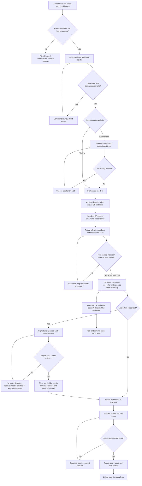
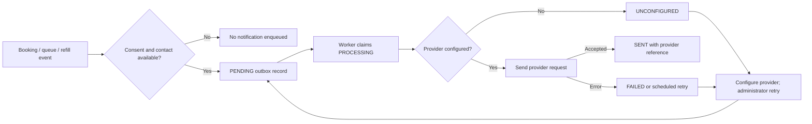
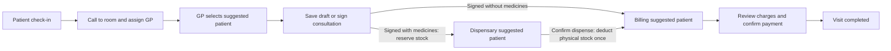

# Clinic system flow

Billing category management: Administration → Catalog choices → Billing categories → add/edit/order/remove/restore → confirm → persist scoped versioned choice → billing refresh. Prepare checkout → choose active category → confirm payment → validate category and save invoice atomically. Rename/remove after payment → historical invoice unchanged; a pending draft requires reselection. Renamed SERVICE/PRODUCT defaults retain automatic consultation/medicine assignment through their immutable default marker.

Local startup: `webapp clinic` → validate registry/configuration → reject occupied application ports → verify owned MySQL instance → start if needed → authenticated readiness → API3101 and Vite3100. Progress uses its own startup script on3001/MySQL3307. Ctrl+C stops the foreground app; databases remain running. Startup never initializes, migrates, seeds or resets data. See [harness instructions](LOCAL_HARNESS.md).

## Main staff workflow

Queue movement, document issuance and checkout are explicit staff actions. Signing does not automatically complete a queue visit or collect payment.

During registration or demographic editing, staff choose a phone calling code and enter the number, or paste a full international number. Unlisted countries use Other country. Blank phone stays optional; unedited existing contacts remain unchanged. The form submits one phone string through the existing scoped patient API.

Non-Malaysian intake requires a separate country of nationality. The scoped patient service validates the ISO code; Malaysian intake stores MY. Missing foreign country remains unknown until explicitly updated.

List navigation follows load authorized records → filter/search the view → select sort/direction → explicitly open or act on a record. Clear filters restores original ordering. Views never alter clinical priority, stock or financial ledger totals.



Confirmed due-appointment arrival links the appointment to one queue ticket and marks it checked in.
The API supports booking cancellation; the current booking screen requires separate API handling for that operation.
See [staff guide](USER_GUIDE.md) for screen-level steps.

## Guided screen walkthrough

Staff open **User guide**, choose an available workflow and start its interactive walkthrough.
The walkthrough navigates to the permitted module and circles the relevant control.
**Next** and **Back** move between explanations; **Close** or Escape ends the walkthrough.
Forms may open for explanation, but saving, signing, dispensing and payments remain explicit staff actions.
Phone instructions remain inside the viewport while the relevant control scrolls into view.

## Request and transaction sequence

```mermaid
sequenceDiagram
  actor Staff
  participant UI as Browser
  participant API as Express
  participant Service as Application service
  participant DB as MySQL
  Staff->>UI: Save workflow action
  UI->>API: Cookie, CSRF, branch, validated payload
  API->>API: Authenticate, authorize module/branch, validate input
  alt Denied or malformed
    API-->>UI: 400/401/403; no operation
  else Authorized
    API->>Service: Server context and input
    Service->>DB: Begin; acquire resource/row locks
    Service->>DB: Check version, invariants and retry key
    alt Stale/conflict/insufficient stock or balance
      Service->>DB: Rollback
      Service-->>API: Domain conflict
      API-->>UI: Error; refresh or correct fields
    else Valid operation
      Service->>DB: Write records, audit and applicable outbox
      Service->>DB: Commit
      Service-->>API: Persisted result
      API-->>UI: Success and optional queue refresh signal
      UI->>API: Refresh affected lists
    end
  end
```

Use current versions after conflicts; never overwrite silently. Retry uncertain financial responses with the same key and unchanged payload.
Failed checkout does not imply an invoice exists. Repeated dispense cannot allocate stock twice.

Signing reduces available stock by reservations, while batch quantity remains physical stock until dispensing.
An expired hold can be replaced with eligible fresh stock during the dispense transaction; failure restores prior holds.
Non-medication supply usage follows its own idempotent allocation and movement ledger, without requiring a prescription or permitting medication bypass.

## Notification delivery



Clinic writes commit independently of provider availability. SENT records provider acceptance, not guaranteed delivery or reading.
Booking messages include calendar/maps context. Queue-near and refill reminders depend on actual eligible server records.

## Document integrity and revocation

Issuance locks MC overlap scope where relevant, snapshots signed clinical data and stores a signing HMAC plus verification hash.
Authenticated PDF reads and public verification check integrity. Public responses exclude patient names and diagnosis.
The issuing GP revokes with a reason; replacement creates a new document rather than modifying the old snapshot.
Issued and historical document actions open a readable letter preview. Downloading its PDF is a separate explicit action.
Certificate redaction and revocation status remain visible in the preview and rendered output.

Prescription history reads the encounter, reservation and dispense/movement ledgers without changing stock.
It shows clinic actions and prescribed frequency; patient dose-taking is not inferred from stock movements.
Clinical staff separately record taken or missed doses against signed prescriptions, with patient-report or staff-observation source.
Medication-taking entries stay in the clinical workspace and do not consume physical stock or prescription holds.

## Administrative lifecycle

Create branch, rooms and staff before scheduling. Active branch-assigned DOCTOR accounts become GP choices automatically.
Role grants enable workflows while clinical authority remains separately restricted.
Room rename/archive checks occupancy and future bookings; historical links remain intact.
Staff deactivation invalidates usable authentication; password changes invalidate sessions.

Architecture, schema and tested failure cases are documented in [architecture](ARCHITECTURE.md), [ERD](ERD.md) and [test cases](TEST_CASES.md).

## Browser demo exception

The demo follows the same screen sequence using sample records in sessionStorage.
It does not execute server authentication, MySQL transactions, provider sends or cryptographic clinical issuance.
Reset demo clears that browser namespace and returns to login; local MySQL records are unaffected.
Reset restores the original fictional workflow examples. They are never loaded by normal MySQL bootstrap.

Administrators configure branch choices → active choices appear in clinical/stock forms → server validates and captures medication metadata → signed prescriptions preserve snapshots → archival hides future choices while preserving historical dispensing and stock operations.

Choose module → choose named task section → complete its form or review its list → switch sections without losing unsaved in-module values. Successful registration, appointment booking, checkout and check-in return to their relevant lists. Selecting a consultation opens Note & prescription; issuance/history live in Documents and prescription/dose events in Medication logs.

Admin selects setting → edits name or removes → unused room deletes / referenced setting archives → future choices hide it → Show removed enables restoration. Safety conflicts leave the setting and history unchanged.

Checkout captures receipt metadata → Invoice history → Preview receipt → readable HTML → Open printable PDF or Download PDF explicitly. Demo displays a sample preview only. Later branch/staff/patient renames do not change newly captured receipt identity.


## Profile, booking and clinical navigation

Directory → patient row/Open profile → full demographics/contact/address and consultation history. Registration → nationality/country in fixed form cell → visible phone prefix → save existing shared validated payload. Appointments → single Book appointment section → ID-sorted patient → today/future Malaysia date → conflict validation → save. Unused booked/cancelled appointment → Delete appointment → confirm → version-checked soft removal and audit. Clinical → grouped patient → paginated history → Open consultation → enabled record tools. New consultation → fresh creation form → save → selected Notes & prescription. Administration → Clinic settings → optimistic name save → future receipt snapshot. User guide → highlighted tabs/functions → close → continue normal workflow.


## Single-entry task and consent flow

Tasks use one section-tab entry point: Clinic overview → Check in patient; Patients → Patient registration; Billing → Patient checkout. Patient registration retains a prominent header shortcut; other duplicate actions are removed; submit buttons still commit the entered form. Clinical workspace starts at Choose patient: search/select → Patient history → Open consultation, or New consultation for the selected patient. Changing patient clears previous record tools. Catalogue rows show concise stock summaries; View details expands metadata, batches and administrator actions. Filter and sort loaded stock reveals advanced controls; Default: Item ID supports both directions. Practitioner registration number is shown and required only for GP/DOCTOR creation; other roles submit null. User guide remains in the header and is removed from the sidebar. Valid form → popup → Cancel/Escape (no mutation, preserve draft), or Confirm → existing API → success/error. Direct persistent actions use the same popup. Invalid native required fields prevent form submission before the popup.


## Simplified arrivals and room calls

Check in patient → Waiting for doctor → Call to room beside that patient → choose available room and doctor → Confirm call → popup consent → Called to room. The previous Ready for triage step is no longer required. Historical TRIAGE_WAITING tickets remain supported. Missing room/doctor configuration and occupied rooms explain why final confirmation is unavailable; the entry action stays available. Patient search is available at check-in, and advanced queue filters are collapsed. Shared section switches retain mounted drafts and no longer force scrollIntoView; overflow anchoring is disabled within the changing task area. Guided tours still scroll deliberately to their targets. Navigation uses current module grants; bootstrap access refreshes every 15 seconds while visible and on focus/visibility return. Unpermitted appointment navigation and written help topics are hidden, and direct routes remain access restricted. Server access checks remain authoritative.


## Check-in expiry and nurse-to-GP flow

Check in → active visit until 12 hours or Malaysia midnight → nurse calls assigned doctor/room → GP Assigned patients → Start consultation → prefilled SOAP form → consented save, linked encounter and atomic start. If nurse already started consultation, suggestion is still shown. Existing encounter → Open consultation. Exact 12-hour cutoff → mark expired/release operational locks → new check-in; prior clinical history retained. Duplicate before cutoff → clear existing-ticket error.


## Signed consultation to dispensary

Assigned patient → Start consultation → SOAP and one or more medicine rows → draft save or SIGNED → popup consent → validate all medicines → reserve all stock → linked active visit DISPENSARY_WAITING → pharmacist pending prescription. Any failure rolls back the complete signed handoff. Existing draft → append rows → save → no duplicates on unchanged resave.


## Draft and reset workflows

Patient → compact history → Open full note, or own Delete draft → consent → versioned soft removal → history/suggestions refresh; selected record tools lock. Signed record → no individual delete. Super Admin → Danger zone → affected-count preview → Reset database → exact phrase + current password + acknowledgment → final erase → transactional reset/default recreation → session ends → sign in with configured bootstrap credentials. Ordinary Admin → no reset controls and server denial.

## Automatic visit stages

Drafts remain editable without stock holds. Signing rejects insufficient eligible stock atomically. Dispensing and payment preserve idempotency. Automatic transitions apply only to the linked active queue ticket; expired visits stay expired.

Prepare checkout → confirm replacement if needed → prefill patient/GP/charges → scroll to checkout below sticky navigation. Cancel → retain entries and scroll position.

## Appointment to waiting queue

Book patient/GP/times without room → scheduled time arrives on Malaysia date → Clinic overview suggests check-in → staff confirms arrival → one linked waiting ticket, booked GP retained, no room yet → staff calls into an available room → GP assigned suggestion → existing consultation/dispensary/billing flow. Canceled, removed, future, previous-day and already checked-in appointments are excluded. Canceling check-in consent creates no ticket. No automated check-in merely because time passes.

Check-in → Register patient shortcut → Patients registration and scroll → explicit save consent → searchable patient directory. Patient search → loading or matching dropdown → pointer/keyboard selection → profile or workflow patient selection. No result → explicit guidance. Canceling unsaved-edit replacement preserves the original form.

## Public display flow

Open `/display` → load active branches without sign-in → choose branch → load anonymous current waiting/called tickets → refresh every 15 seconds. Clinic names distinguish identical branch names. Show room names but no patient or practitioner names. Expired, completed/skipped and prior-day visits leave this public screen. Staff workflows remain authenticated.

## Daily queue and temperature flow

Today’s ten visits remain ten after completion or expiry → Malaysia midnight → previous-day rows leave the live queue/count → unfinished visits expire → fresh check-in starts Q-001 with a new numeric ID. Stored clinical, prescription and payment history remains available. Temperature entry → optional blank or numeric 28°C–40°C inclusive → save; outside range → reject before mutation.

Non-Malaysian patient → Country of nationality → Others → enter country name → validate and confirm save → profile shows custom country. Choose an ISO country or Malaysian nationality → custom field clears → subsequent profile uses selected country. Legacy edits omitting country fields retain the saved custom label.

Search text → matching suggestion → click or Arrow/Enter → full label in input and matching record selected, without saving. Unsaved clinical patient switch → Cancel → original patient, query and note preserved. Public display → Enable announcements → sample sound → new call/room → chime; disable/close → release audio context.

Enable announcements → spoken sample and chime → newly called ticket or changed room → chime → read ticket digits and room destination. Multiple new calls → queued spoken sentences. Branch change/off/close → cancel pending speech; unsupported voice → recovery notice with chime retained.
